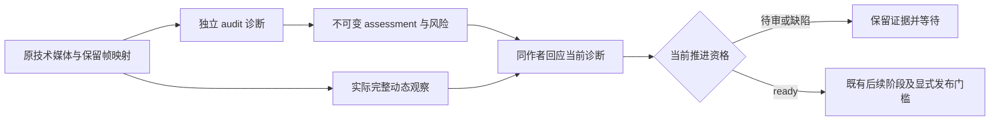

# VCO-04：诊断接入观察门槛与版本化恢复

## Goal

将 VCO-03 的连续性证据接入现有片段观察、后代生成、超分、合成与发布检查，使调用者能够定位风险并保留动态观察依据；诊断缺失、损坏或尚未回应时，不能沿用旧的推进资格。

任务以 `docs/task-handoffs/video-continuity-optimization-task-board.md` 的 VCO-04 为准。2026-10-26 用户明确要求“完成04任务的设计”，设计交付时仅回填Design document、保留NOT_STARTED。随后VCO-03按AI路线登记COMPLETED，用户继续要求同步交接；现已写入并关联 `docs/task-handoffs/VCO-04-handoff.md`、将本任务准备为 `READY`。设计和交接就绪不表示实现已开始；尚未启动实现、模型服务、GPU/付费试验、发布或真实素材重测。

直接依赖是 VCO-03 的软件分析接口与实际证据格式。VCO-03主任务已按用户选择的AI路线登记 `COMPLETED`，AI实验交付及时间片段重播补充已完成；原正式双人Benchmark协议仍未验收，是单列限制，不再代表主任务BLOCKED。本任务的软件设计消费已交付接口，不将前置实验转记为真人或生产验收，也不把不存在的六项 ready profile 列为已有输入。

## Scope

包含以下工作：

- 为显式启用的新 scene run 冻结诊断策略，建立独立、不可变的诊断代次、输入绑定、审阅回应和推进资格记录。
- 显式调用现有 `analyze_continuity()`，在独立 audit run 中测量；绑定生产媒体、裁片映射、分析帧、起点 ROI、合理变化声明、算法/参数/依赖和报告。
- 将机器证据送入同一次完整动态审阅，保留现有 `human_video` / `agent_video` 观察协议；不要求重新填写 VCO-03 双人校准表。
- 对后代新请求、source-clips-ready、超分、合成和发布执行当前代次检查；诊断重算仅失效诊断及其回应/推进资格，保留模型请求、原视频、PCM、字幕、图片及已完成的媒体工作。
- 恢复检查与本地故障测试；旧 run 完全沿用原来的 options、graph、观察、修订和恢复格式。

不包含新的重播/色彩算法、阈值拟合、AI 标注补做、校色、自动重生成、自动主体识别、生成模式/长度/帧率调整、新网页或模型播放工具安装。VCO-05/06/07/08 的模式与实际试验均不在本任务。

`scripts/experiments/vco03_temporal_replay.py` 等实验实现和固定控制 case 保留为研究证据，不直接导入生产 runtime。它们的编码 Y 分数不得套在 `continuity_cv_v1` 的 sRGB 分数上。

## Approach

### 1. 已核对的现状与方案选择

| 当前接口 | 本设计沿用的事实 |
|---|---|
| `production_scene_clips._technical()` | `clip.json`、`mapping.json`、`last-frame.json` 在技术媒体核验后写入，完整观察尚未发生 |
| `scene_clip_observations.build_observation_template()` / `validate_scene_clip_observation()` | schema 2，精确媒体/父片身份，完整保留帧区间，仅接受实际 `human_video` / `agent_video`；首片 `parent_join=null` |
| `production_scene_clips._consume()` | 保存原始观察字节和 accepted/rejected receipt；已接受/失败的观察不可覆盖 |
| `scene_clip_records.collect_progress()` / `complete_value()` | 顺序验证原始父子链；未经父片接受不能生成后代；`complete.json` 是不可变的 schema 2 聚合 |
| `scene_media_records.scene_media_context()` | 超分/合成/交付入口经 `require_scene_clip_acceptance()` 检查，已有完成前缀可只读验证 |
| `production_scene_pipeline._preflight_later()` / `_restore_missing_aggregates()` | 后续证据先检查，恢复原聚合后才允许新外部作用；需补充诊断检查以防后续完成前缀绕过 |
| `scene_revision.plan_scene_revision()` | 内容依赖和 admission 依赖已分开；不能把诊断代次加入内容脏节点而触发视频/超分再生成 |
| `continuity_analysis.analyze_continuity()` | 只接受原生已证明映射和颜色分析帧，写新的非 production audit；返回 report 与输出路径；没有持久化的纯内存结果不具审计资格 |

考虑过三种接法：直接用 AI 阈值自动放行（算法/分析空间不同且无完整动态证据，排除）；把诊断字段塞进旧 clip/request/complete（会改变旧请求与已完成媒体身份，排除）；采用独立诊断代次与推进资格旁路（选择）。这是基于现有不可变记录的工程选择，不改变生成契约。

策略只提供 `advisory_v1`：机器结果提供证据与风险，实际动态观察决定是否发现缺陷，结构完整性和回应完整性决定能否推进。没有“机器 passed”状态。完整动态观察作者可以是具备实际播放能力的 agent，不要求两名真人。

### 2. 三种状态不得混写

1. **机器测量**：保留 VCO-03 的 `candidate / no_candidate / not_comparable / unverified`、原始分数、支持度、风险和范围。`no_candidate` 也不表示视频质量通过。
2. **动态观察**：原 schema 2 的 `passed / failed / unverified`，仍检查实际完整播放、身份、动作过程、光照、父片接点等十项内容。
3. **当前推进资格**：新增 `awaiting_analysis / awaiting_review / blocked / ready_for_next_stage`。只有有效诊断记录、有效完整动态观察、当前代次全部风险回应与无缺陷结论共同成立，才是 ready。

原始机器 unverified 不会被改写为 normal/passed；若只是未校准、匹配不足或范围外，实际动态观察可在独立回应中记录“完整播放未观察到该类缺陷”，解除该项待审。报告缺失/漂移、分析进程失败、无法证明覆盖的片段、动态观察 failed 或回应确认缺陷均不能靠该回应解除。无法完整播放时保留 unverified 和等待状态，不以静帧审阅冒充 `agent_video`。



### 3. 配置、冻结与旧 run 分支

新配置仅可额外包含：

```json
"scene_continuity": {"schema_version": 1, "policy": "advisory_v1"}
```

两字段必须同时提供，拒绝未知字段、其他 policy、bool 版本、null/部分配置；仅 `paragraph_jimeng_v1` 支持。无该配置时，所有旧配置解析、options 字段集合、身份角色、graph、请求、观察和聚合字节保持原规则；不得给旧 options 补默认键。

启用时，`freeze_inputs()` 把精确配置写入 `production/scene-continuity/policy.json`，在已有 `execution_policy.input_identities` 增加唯一角色 `scene_continuity_policy`，仍使用原 FileIdentity。`load_frozen_inputs()` 仅在原冻结 config 含该配置时要求该角色及准确路径；存在配置缺少角色、角色无配置或文件 SHA 漂移均拒绝，不能退回 legacy。不增加 options 顶层字段、不改 schema 2。

新 run 第一次已有已提交 scene plan 时，先在持有 RunLock 的调用线程建立初始诊断代次，再允许 Wan 提交。此处只冻结输入契约和代码/包身份，不运行测量，也不调用服务。缺可选数值依赖时返回 blocked，保留原输入；无配置的 run 不导入数值依赖。

启用策略只影响新 run。旧冻结 run 不支持原地补装；本轮不提供自动迁移，不重写旧 `production/options.json`。

### 4. 身份约定、目录和精确结构

运行记录中 `Artifact` 精确为 `{path, bytes, sha256}`，沿用 `SceneClipStore` 的实际字节核验规则。VCO-03/02 分析输入继续使用原五字段 `FileIdentity`，不能用三字段 Artifact 冒充。`*_sha256` 在本节新结构中一律为文件原始字节 SHA；`*_digest` 为 `canonical_digest()` 的 JSON 内容摘要。现有 request/clip 字段仍按原定义，不重解释。

所有新 JSON `schema_version=1`，拒绝未知键；非 bool 整数、有限数字、规范 UUID、timezone-aware ISO 时间；运行路径采用既有绝对本地路径规则，拒绝 alias、UNC、symlink/junction、硬链接替代及越界。Artifact.bytes通常≥1；被已验证CommandResult明确命名的stdout/stderr日志可为0，沿用现有命令空日志守卫。2026-10-27实施核对发现NumPy实际RECORD还包含合法的0字节marker/source成员，故仅对准确已验证的RECORD成员及其逐字节engine归档副本保留这一例外，以避免遗漏库存和改变原fingerprint；不能放宽报告、原始作者JSON或其他文件为空，详见实施账本/验证文档。外部分析来源须位于 `D:/VideoSi`，注册时核验完整依赖，不得只验证路径存在。单 JSON ≤16MiB，同次解析元数据 ≤64MiB；最多4096帧、65536比较，沿用分析器192MiB图像缓存上限。超限报告明确拒绝，不自动抽帧或截断。

目录根为 `production/scene-continuity/`；旧 `production/scene-clips/` 的 clip/request/complete/观察 receipt 保持原格式。

| 文件 | 精确字段 |
|---|---|
| `policy.json` | `schema_version, policy`，与配置字节含义相同 |
| `epochs/<epoch_id>/intent.json` | `schema_version, run_id, epoch_id, previous_commit, clip_ids, engine, reason, requested_at` |
| `epochs/<epoch_id>/commit.json` | `schema_version, run_id, epoch_id, intent, engine_archive, created_at` |
| `jobs/<assessment_id>/intent.json` | `schema_version, run_id, assessment_id, epoch, clip_id, binding, manifest, created_at` |
| `jobs/<assessment_id>/attempts/<attempt_id>/intent.json` | `schema_version, run_id, assessment_id, attempt_id, audit_run_dir, job, created_at` |
| 同 attempt 的 `terminal.json` | `schema_version, run_id, assessment_id, attempt_id, status, report, outputs, failure, finished_at` |
| `jobs/<assessment_id>/assessment.json` | `schema_version, run_id, assessment_id, epoch, clip_id, job, attempt, binding, manifest, report, closure, concerns, created_at` |
| `jobs/<assessment_id>/review-template.json` | 与下述 Review 完全同字段，作者/时间为空、回应为 unverified，不可准入 |
| `reviews/<sha256>.json` | 保存 Review 的原始提交字节 |
| `reviews/<assessment_id>/receipt.json` | `schema_version, run_id, assessment_id, assessment, review, video_receipt, state, created_at` |
| `prefix-observations/<sha256>.json` | 保存下述PrefixObservation作者原始字节；仅三段及以上前缀需要新结构 |

`previous_commit / intent / engine_archive / epoch / job / attempt / manifest / report / assessment / review / video_receipt` 均为 Artifact，只有首个 epoch 的 `previous_commit` 可为 null。video_receipt指向原observation-accepted或observation-rejected receipt，必须与Review视频观察的verdict对应，不将failed叫作acceptance。`clip_ids` 按已提交 plan 的全部片段顺序精确覆盖；本版本重评估覆盖全 run，避免局部新旧代次混合。

`Engine` 精确 `{algorithm, parameters_sha256, implementation, dependency_fingerprint}`。algorithm固定现有 `continuity_cv_v1`，parameters为现有 PARAMETERS 的摘要；implementation 为分析器、schema/score/geometry/audit、colorimetry 与新增报告校验器实际源码 Artifact 的排序去重列表；dependency_fingerprint沿用 VCO-03 Python/NumPy/OpenCV、build information、包 RECORD 及算法源码集合的定义。捕获函数只读，不创建日志或更改线程；完整 build 文本与包身份在实际 attempt 审计中持久化。仅启用策略分支读取此身份。

`Binding` 精确 `{scene_id, clip_id, clips, selected_image, comparison_images, visual_bible_sha256}`。clips 按同一 scene 从首片到本 clip 的完整前缀顺序，每行精确 `{clip_id, clip_record, request, generated, source, mapping, last_frame, source_frames, output_frames}`；文件字段均为已验证 Artifact，分别对应clip.json、request.json、generated.mp4、source.mp4、mapping.json、last-frame.json（其PNG另纳入closure）；source_frames 为 source.mp4局部 `[0,N)`，output_frames 为 plan 对应全局半开区间。selected_image/comparison_images保留 request 原值；visual_bible_sha256沿用原输入的内容摘要含义。

`Terminal.status` 只允许 `completed / failed / interrupted`。completed 必须 report 为准确 audit 输出 Artifact、failure=null、outputs为完整实际输出列表；失败/中断 report=null，failure精确 `{kind,message,evidence}`，outputs仅列已产生文件，不能把残缺结果提升为 assessment。失败记录不是视频外观 failed；当前资格仍 blocked。

`closure` 为排序去重 Artifact 列表，包含所有原媒体/技术记录、manifest、分析帧记录及其 raw/sidecar/命令日志/工具、regions/context、可选正式 profile 的完整证据、报告依赖/build/metrics/pairs/证据图。每个引用的嵌套 JSON也核验，不因顶层 report SHA 相同就跳过。生产外的来源只读；独立 audit 输出由其原 attempt 持有，不能借另一个 run 的 receipt。

### 5. 代次链与算法变化

初始 epoch 的 clip_ids 来源是已提交 plan。后续显式 `reassess` 请求精确 `{schema_version, run_id, epoch_id, previous_commit, reason, requested_at}`，其 previous_commit 必须是当前唯一链头；新 Engine 由当前安装代码与包实际导出，不接受调用者填写摘要或阈值。

current epoch 由唯一线性的 commit→previous_commit 链确定，不按目录时间、文件名大小或“最新run”选择；拒绝分叉、循环、重复 ID、外来 run、丢失中间项。`intent` 必须先写、commit最后写；未完成 intent 存在即冻结当前推进，不能回退到旧 epoch。恢复仅继续相同 intent，Engine 漂移则拒绝并保留故障证据。

为使算法/包升级后仍能验证历史缺陷，而不要求旧安装目录永远不变，intent写入后、commit前，将该Engine的实际源码、依赖包RECORD非pyc文件和build文本字节复制到本epoch的`engine/`，生成engine_archive指向的`engine/manifest.json`。该manifest精确 `{schema_version,engine_digest,versions,build_information,files}`，versions精确 `{python,numpy,opencv}`，files按原path排序，每项精确 `{original,archived}`；original为原五字段FileIdentity，archived为本epoch Artifact；build_information为本epoch build文本Artifact。校验复制前后source与archive的bytes/SHA相同、原metadata与捕获Engine一致，再写commit。固定单epoch归档预算512MiB、1MiB流式复制，先预检磁盘空间，超限/超时拒绝并保留intent；原有192MiB图像内存预算不变。

当前epoch有效性同时要求当前安装身份和归档身份匹配；历史epoch只读复核其原媒体/报告/作者字节和绑定的代码/包归档，不要求这些旧文件仍占据当前安装路径，也绝不从archive加载执行旧Python/二进制。历史schema2原观察仍按原协议验证。历史诊断校验是模块私有函数，只用于取证/缺陷继承，不能为当前epoch发放ready或作为公开skip开关。这样源码升级不会既让历史取证无法读取，又让confirmed_issue丢失。

算法/参数/包变化后，旧 epoch 是历史证据，不能继续作为当前准入；read 路径返回需要 reassess，绝不隐式产生新代次或改旧阈值。reassess 提交后，原视频、HTTP意图/prompt_id、原完整动态观察、超分和编码字节均保留；所有当前诊断和诊断回应待重做。旧动态观察只在媒体及完整父片上下文身份完全相同时可作为本次回应的播放依据；新的回应时间必须晚于新 assessment，不能自动沿用旧回应。

一个 epoch 每 clip 只允许一个 assessment_id，首个 intent 即锁定该映射；重复提交相同 ID/字节幂等，不同 ID 争用同 clip 拒绝。已 terminal failed 的 job不原地重试：需要显式新 epoch，代价是本地诊断重算，不产生模型请求。

不把 epoch ID 加入原 graph/request/clip/source aggregate、超分内容 key 或 `scene_revision` 内容失效图。诊断专属变更走 reassess，不使用 `reconfigure` 来更换诊断版本。提示/生成模型/选图仍走原 revision；新 run 的策略同样需要冻结，只有内容身份完全相同的分析输入可以复用，不直接继承旧 run 的 ready receipt。

### 6. 分析输入、覆盖和现有报告的接入

独立入口接收 Analysis Request，精确 `{schema_version, run_id, assessment_id, epoch, clip_id, manifest}`。manifest 为真实文件 Artifact，其内容必须通过 VCO-03 ordinary manifest 校验；`purpose=benchmark_control`、控制 display_map、实验 profile、实验 case JSON均拒绝进入本 run 当前报告。

先调用现有只读技术校验，取得可信 clips/requests/mappings，再导出 Binding。每个 manifest clip 必须精确对应 Binding 中同 scene 的保留前缀，帧索引、generated→retained→output 映射与 PTS均匹配；父子接点只能是父最后保留帧→子首个保留帧，不能用子输入PNG、已丢弃的头帧或随意选出的两个关键帧代替。

manifest.scope固定scene、scene_id必须等于Binding.scene_id、timeline固定现有正式16/1；domain.source_kind必须为generated，genre由作者明确声明六类之一或unspecified，不能从文件名/像素猜测，也不能把当前模型产物伪装为captured来命中profile。原生PTS与output映射仍独立核验，固定16/1不允许重写不相符的输入时间。

每个前缀 clip 的全部保留帧恰好出现一次，分析帧来源统一为Binding.source对应source.mp4，逐帧验证原generated→retained→output映射链；所有相邻比较与每个实际接点比较必须覆盖。固定 reference 使用该scene首片首个保留帧的独立VCO-02分析记录：由独立sidecar/分析audit再次证明相同source SHA和frame_index，使用不同record路径，不能给clips内同一record路径伪造第二个ID（原ordinary校验会拒绝）。对其后的所有保留帧作 reference 比较；首帧自身不重复制造same_frame。对三段及以上前缀保留 cumulative_color，不能仅检查最后一个接点。regions每个涉及clip恰有起点anchor，另包含该独立reference记录的ROI；不能用未来truth跟随。ROI和合理变化由明确作者输入（可为AI草拟），不自动套全画面或从素材名猜。没有这些输入时停在 awaiting_analysis，提供缺项，不伪造语义主体。

数据准备复用 VCO-02 的 `inspect_color_asset()` / `decode_analysis_frame()` 及证明映射；由独立诊断操作写新 audit，不能在生产进度查询中解码或建立 sidecar。源色彩 unknown/conflicting仍保留；若已取得可验证的 unverified 分析记录，则分析器可生成对应弃权报告；缺少完整帧/映射不等于有一份完整 unverified 报告。

`profile=null` 合法，产生原始未校准测量；已有 `purpose=real_benchmark` profile 仅在原验证器、完整证据闭包、算法/参数/依赖和适用域全部满足时应用。当前 AI 实验 profile 实际不满足该普通结构，因此禁止改字段伪装准入。AI实验来源、指标、限制仅链接到操作说明，不进入当前 clip 分数/阈值。当前软件可以在无 ready profile 条件下完成诊断→实际观察的证据接入，不能据此宣称自动准确率或生产算法验收完成。

新增公开只读 `validate_continuity_report(report_identity, manifest_identity, *, config, expected_engine, timeout=300)`：返回已核验报告与完整 closure，不写日志/文件/锁，不重新执行检测。要求精确 report 字段：`schema_version,algorithm,parameters,parameters_sha256,input_sha256,inputs,dependencies,scope,scene_id,domain,frame_results,comparisons,trajectories,detectors,coverage,profile,risks,created_at`，与当前analyze_continuity实际输出一致。检查 canonical input_sha256、原 frame/region/context记录、依赖集合/构建指纹、六类 detector、准确比较集合/时间/coverage、metrics及逐pair文件内容与报告一致、所有证据身份及 profile适用/封存证据；不能只相信输出 exit 0 或 path。源码身份按本 epoch 检查，历史报告不能因当前源码漂移被自动算作当前 ready。

生产 report不能来自任意第三方手写JSON：必须在预先持久化的 attempt.audit_run_dir 的固定 `logs/continuity/report.json`，由该intent绑定的 Engine/manifest运行；外部调用现有 `continuity_audit.py analyze` 产生的报告也需通过一个显式导入请求建立新 attempt，再完整核验 provenance，不能直接把旧路径标为新原始producer。v1实现只提供自有 attempt 路径，不开放该导入快捷方式。

### 7. 事务、恢复和实际副作用

所有生产根目录写入必须持有同run的既有 RunLock，并在每次持久化前后检查owner；使用exclusive临时文件+fsync+rename、相同字节幂等，不覆盖旧证据。分析阶段可持续持锁，最长300秒；deadline共享给分析/核验，不给每一步重新发放300秒。

流程：预检全部现有前缀/当前epoch/输入→写job intent→写预分配独立audit路径的attempt intent→调用既有分析器→读取者退出并复核输入→写attempt terminal→核验closure→写assessment→导出待审材料。到最后一步之前都不生成ready。assessment只绑定completed terminal和其原始输出，跨attempt借receipt拒绝。

独立 audit 不能使用 production logger；生产端仅保存 intent、引用及必要的原始作者提交。不得用审计代码实例化源生产logger。提供同步 fault-injection `boundary()`，至少涵盖 epoch-intent/epoch-commit、job-intent、attempt-intent、analysis-report、attempt-terminal、assessment、review-original、review-receipt。

恢复规则：

- intent存在、attempt未开始：继续相同job，原始request不会变。
- audit完整report存在、terminal缺失：重新只读核验 report/完整闭包后写 `completed` terminal，记录恢复事件；不声称另一个producer执行了本次任务。不重新调用测量器。
- audit只有部分输出：保留原attempt并写interrupted terminal；显式resume可在同job建立一个新attempt，重新运行本地确定性分析，不能重用污染的非空AuditWindow。同次resume最多启动一个attempt。已有completed terminal禁止第二次检测。
- assessment缺失：从唯一completed terminal重建精确assessment；多份成功结果冲突即拒绝，不挑最新。
- 观察raw已保存、receipt缺失：沿现有恢复规则重验原raw和当前assessment后补receipt，不另造观看时间/作者。
- 原模型submit_unknown/running仍仅走现有request/prompt_id/HTTP恢复。独立诊断或reassess不得启动服务、联网、调用任何模型客户端；无法取得技术完成片段则等待。

独立诊断结果 `SceneContinuityResult` 精确字段 `{schema_version,run_id,run_dir,status,epoch,assessment,review_template,log_dir,error}`；status为 `awaiting_analysis / awaiting_review / reviewed / blocked / failed / interrupted`，退出码分别3/3/0/2/1/130；error为null或现有 `{kind,message,evidence_paths}`。这里 reviewed只证明该次回应完成，不代表整run ready或视觉passed。

### 8. 动态观察与风险回应

保留原 `scene_clip_observations` schema 2，不往 `observation-template.json` 或 `observation-accepted.json` 加诊断字段。每次assessment另生成 `review-template.json` 和易读Markdown；显示当前clip、完整播放范围、父片接点、六项测量/弃权、原始证据路径、分析域和未校准限制，避免让作者从实验case名推断真假。

`concerns` 精确列表：每条 `{concern_id,detector_id,region_id,frame_ids,status,score,reasons,evidence}`。从报告的detectors原始行逐行派生，detector_id取原六枚举，status保留原值；除 `no_candidate` 外都需回应，不自行合并不同帧的行。concern_id为 `canonical_digest({detector_id,region_id,frame_ids,status,reasons})`，frame_ids按report顺序；重复ID且内容不同拒绝，完全相同的重复行只保留一条；evidence为原证据Artifact投影，不能删掉不可比/未校准项。score可null；没有可测窗口仍有相应unverified项，region_id可按原报告为null。

Review 精确 `{schema_version,run_id,assessment_id,assessment,video_observation,prefix_observation,reviewer,reviewed_at,responses}`。video_observation为原schema2观察文件Artifact（不是receipt）；作者必须与该观察的reviewer相同，reviewed_at不早于assessment.created_at和所有引用观察的viewed_at且不晚于当前时间。视频观察仍经原validator核验完整generated/source/parent与播放区间、所有检查和实际review_method。

完整前缀的播放证据不能从“分别有人看过每段”推断。prefix_observation为Artifact：仅一段或两段时必须等于video_observation，其既有clip/parent播放范围精确覆盖该prefix；三段及以上必须引用独立PrefixObservation，精确 `{schema_version,run_id,assessment_id,assessment,review_method,reviewer,viewed_at,playback,start_observation,process_observation,end_observation,quality_observation,checks,verdict,issues}`。playback按Binding.clips原顺序精确列出 `{clip_id,source,source_frames,output_frames}`，无缺段/重排/截短；review_method仅human_video/agent_video，reviewer与Review和当前clip观察同一作者。四段观察文字非空，checks精确 `{subject_identity,color_lighting,motion_process,camera_path,cumulative_color}`，均为passed/failed/unverified；verdict计算沿用原规则（全部passed且issues=[]才passed，有failed且issues非空则failed，其余存在unverified则unverified）。issues每条 `{check,clip_id,frames,description}`，绑定适用check及本地合法半开区间，文字非空。viewed_at在该prefix所有技术媒体完成之后、Review.reviewed_at之前。

PrefixObservation必须来自该作者按顺序实际完整播放这三段及以上内容；不同作者的祖先accepted观察、缩略图或数字不能代替。允许同一次完整观看产出原clip观察和PrefixObservation，不要求为了填不同记录重复观看，也不自动复制祖先结论。重评同媒体时可显式复用已有完整PrefixObservation，其assessment引用作为历史播放上下文验证，当前Review仍须指向新的assessment并重新回应；源媒体、顺序、范围和作者须完全一致。

responses必须对所有concerns精确一一覆盖，无重复/多余；每行精确 `{concern_id,disposition,reason,references}`。reason为非空作者文字，references为已验证Artifact列表，允许空；disposition仅：

| disposition | 要求与资格 |
|---|---|
| `not_observed_in_full_playback` | 原视频观察与完整prefix观察均passed且身份/完整范围正确，作者说明对应运动/色彩现象；保留原机器状态，允许该concern已回应 |
| `explained_change` | 上述完整观察成立，references必须包含冻结context中命中该detector/region/帧范围的声明；无声明不能使用此项 |
| `confirmed_issue` | 保留作者问题说明，当前epoch资格blocked；原accepted观察保留为历史，不能覆盖为新passed |
| `unverified` | 无法确认，当前资格awaiting_review；静帧AI和无播放能力的agent不能使用前两项 |

无concern的报告仍要提交Review绑定assessment和真实完整视频观察，responses=[]；防止把no_candidate自动升级为推进资格。动态观察failed时永久阻断该候选版本，沿原revision流程；unverified只保存原始材料，不产生ready receipt。

Review的持久化规则固定为：任何结构有效的作者提交先保存原始SHA命名文件；只要视频/前缀verdict或任一response为unverified且没有失败项，就只保存raw，不写唯一的`reviews/<assessment_id>/receipt.json`，允许后续另一份完整Review补齐。同一次查询须校验保留raw清单和全部有效raw；不能把“有raw但无receipt”当作已回应。首份终态ready/blocked提交才写该唯一receipt，state仅为ready_for_next_stage/blocked，后续同字节幂等；不能用新passed覆盖已有blocked。ready存在后新出现的有效confirmed_issue/failed前缀原始提交同样阻断，即使中断尚未写receipt。普通unverified补充不能抹掉已完成的同一回应，终态冲突拒绝。

确认缺陷与真实failed观察对同一候选媒体永久有效，不能靠换epoch忘掉。其作用范围由assessment的Binding媒体内容定义：当前clip及完整prefix的source SHA、局部范围和顺序相同，就必须保留该阻断；复制路径、跨run继承同源媒体或仅改诊断版本均不解除。需要实际替换相关媒体的原有revision，并重新完整观察。revision来源取证需携带相关诊断failed/confirmed_issue原始提交；新run不得只继承原accepted视频receipt而漏掉这个更晚的失败事实。

新 `make-video --continuity-review PATH` 与已有image-selection/clip-observation/final-observation/revision/publish互斥，仅run-dir动作。该动作读取Review引用的原视频观察，若尚未收取，则在同一持锁调用中调用现有 `_consume` 保存/验证该观察，再建立旁路review receipt；已存在时要求原始字节与receipt完全相同。仅消费证据，不自动推进后代生成。用户/有实际播放能力的agent可在同一次观看中产出这两份机器可读材料，不要求重复观看或双人表。

普通 `--clip-observation` 对启用策略的run仍可以保存原schema2观察，但未完成当前诊断回应时只返回awaiting_continuity_review。调用者不能通过只走旧action绕过旁路门槛。

### 9. 当前资格计算与接入点

新增只读 `load_scene_continuity_progress(frozen, units, timeline)` 返回精确 `{schema_version,run_id,policy,current_epoch,clips,ready}`；未启用时policy/current_epoch=null、clips=[]、ready=null（不表示有诊断）。启用时每clip精确 `{clip_id,assessment,review,state,reasons}`，assessment/review为Artifact或null。ready只在所有plan clips均有ready_for_next_stage时为true。

新增 `require_scene_continuity_acceptance(..., clip_id=None)`：未启用时返回None；启用时校验当前唯一epoch和完整闭包，指定clip时要求该clip及其同scene完整祖先前缀均ready，无clip时要求全plan ready。祖先前缀检查用于保证后代单独ready不能掩盖同源祖先已确认的缺陷，其他scene不参与这个指定clip的状态门槛。只能在本次调用内缓存已核验字节，退出和外部作用前复核；同size/mtime字节漂移或新增矛盾原始观察均拒绝。

| 接入位置 | 具体行为 |
|---|---|
| `production_scene_clips._produce()` | 首次生成前确保初始epoch；对子片已有父accepted的分支，在child请求/服务启动/POST之前要求父clip当前诊断资格。对已存在后代先验证原技术链，不能把“当前重评待审”误判成“历史上未曾接受父片却生成了后代” |
| `_technical()` 后 | 技术完成就可以构建诊断模板/缺项说明；不在这里猜ROI、自动跑分析、自动签观察或发起后代 |
| `_finish()` | 原完整视频观察仍按原规则聚合；启用run额外要求全plan当前资格才返回source_clips_ready。待分析/待回应统一映射原SceneClipResult.awaiting_continuity_review，错误证据说明真实原因 |
| `scene_clip_records.require_scene_clip_acceptance()` | 先验证原schema2 complete和完整视频观察，再额外require当前诊断资格；不改变返回的旧complete内容 |
| `scene_media_records.scene_media_context()` | 捕获当前epoch/assessment/review闭包进入调用期guard；`verify_captured_bytes()`在新超分提交、编码、交付前复核 |
| `production_scene_pipeline._preflight_later()` / `_restore_missing_aggregates()` | 先检查当前资格；当前待审时返回source_clips阶段等待，不因已有composition ready或丢失聚合恢复而跳过门槛，不触发Wan/超分服务 |
| `production_scene_delivery._produce()` 与已有completed delivery重放 | 进入原最终完整观察/显式publish前要求当前资格；已有交付不重新发送/覆盖，当前重评未完成时禁止新发布，并返回过期资格原因 |
| revision读取/导入 | 原媒体和原观察按原祖先身份只读验证；诊断新run单独建立epoch。继承媒体需保留其准确origin路径/证明，不能把历史ready跨run自动搬来 |

`collect_progress()` 中原accepted/rejected语义不改，不清空旧receipt。当前诊断等待是独立overlay，不能导致后代原证据被误判为非法、被删除或重新生成。原 `complete.json` 保持schema2原字节；当前资格按旁路每次新鲜验证，不新增可被遗忘的“可变ready索引”。

所有 make-video advance/publication 路径都必须检查：不能只在 CLI 或只在 `_finish()` 检查。纯查询不提取新的分析帧、不运行诊断测分、不写入或恢复文件，不能查询一次就重新诊断。2026-10-27实施核对澄清：本节的诊断解码禁令不跳过既有只读技术媒体核验；`scene_context/collect_progress`原协议包含ffprobe及只读完整解码/尾帧像素核验，仍保留以满足媒体身份与旧协议兼容。状态查询因此可能消耗CPU解码和文件核验时间，但不会新建分析记录、调用模型或修改原片。这里不引入可传入的skip/historical旁路；详见实施账本。

### 10. 显式操作与公开接口

新增 `scripts/scene_continuity_audit.py`，通过现有bootstrap执行，仅提供：

- `analyze --run-dir ABS --request ABS`：读取Analysis Request，在原冻结config/工具下做本地诊断；支持按同request显式恢复。没有profile不影响保存诊断，返回awaiting_review/退出3。
- `reassess --run-dir ABS --request ABS`：提交上文Reassess Request，建立新epoch并返回awaiting_analysis/退出3，不隐式重算所有clip。
- `status --run-dir ABS`：只读状态JSON，完整校验当前闭包；ready时退出0，等待3，损坏2。

不接收URL、glob、“latest”、内存阈值或替换config参数。所有runtime路径D:/VideoSi，失败输出精确错误证据，不追加GPU请求。

主要新接口：

```python
# runtime/scene_continuity_records.py：无写入/服务
load_continuity_policy(frozen) -> dict | None
load_scene_continuity_progress(frozen, units, timeline) -> dict
require_scene_continuity_acceptance(frozen, units, timeline, *, clip_id=None) -> dict | None
validate_continuity_review(value, expected, *, now) -> dict

# runtime/production_scene_continuity.py：持锁、本地事务
analyze_scene_continuity(frozen, units, timeline, request_path, *, paths, logger, lock=None, timeout=300) -> SceneContinuityResult
reassess_scene_continuity(frozen, units, timeline, request_path, *, paths, logger, lock=None) -> SceneContinuityResult
consume_scene_continuity_review(frozen, units, timeline, review_path, *, paths, logger, lock=None) -> SceneClipResult
```

records模块内部用既有只读技术验证取得clip记录，不调用新增require入口自身，避免 `require_scene_clip_acceptance → require_continuity → require_scene_clip_acceptance` 递归。consume先调用原_observation消费内部函数，完成旁路写入后再_finish，保证持锁与幂等不依赖重复public entry。无策略分支不检查不存在的诊断目录、不改旧返回对象。

历史读取与当前资格的具体拆分：将原 `require_scene_clip_acceptance()` 的schema2验证体提取为模块私有 `_require_scene_clip_base_acceptance()`；公开入口在该体之后追加当前诊断require。`scene_media_context()` 的历史内容构建先使用私有base体验证旧clip/观察，再捕获当前诊断状态与guard；只读completed-prefix重建和revision来源取证可以完成历史字节验证。任何新超分/编码/发布writer及公开媒体require入口必须先调用当前诊断require，不能把“已构建技术context”当作当前准入。不存在可由CLI/JSON/公共API传入的skip-continuity或historical-mode开关；待审状态由协调器返回原source_clips等待结果。此拆分只使历史证据可读，不给新外部作用提供旁路。

## Files

以下均为**实施时**目标；本次只创建本设计文档并回填任务板。

| 文件 | 责任 |
|---|---|
| `src/video_ai/runtime/scene_continuity_records.py`（新增） | 策略、epoch链、binding/closure、review、只读资格和schema校验 |
| `src/video_ai/runtime/production_scene_continuity.py`（新增） | 本地analysis/reassess/review事务，独立audit与恢复，不含模型客户端 |
| `src/video_ai/media/continuity_report.py`（新增） | 现有ordinary报告只读验证、实现/依赖身份捕获；不移植实验算法 |
| `scripts/scene_continuity_audit.py`（新增） | 三个显式本地操作；严格参数/结果/退出码 |
| `src/video_ai/config.py` | 可选scene_continuity精确解析，旧无配置不变 |
| `src/video_ai/runtime/production_inputs.py` | 新run策略文件冻结、条件身份角色、完整性检查 |
| `src/video_ai/cli.py`、`src/video_ai/production.py` | 互斥continuity-review动作、提交原始作者字节、consume不推进生成 |
| `src/video_ai/runtime/production_scene_clips.py` | 初始epoch、父片当前资格、_finish overlay及consume衔接 |
| `src/video_ai/runtime/scene_clip_records.py` | 旧complete之后的新资格检查；暴露无旁路递归的技术上下文读取 |
| `src/video_ai/runtime/production_scene_pipeline.py` | 后续完成前缀/聚合恢复前检查；等待返回且无新POST |
| `src/video_ai/runtime/scene_media_records.py`、`scene_completed.py`、`production_scene_delivery.py`（同runtime目录） | 当前资格守卫传播至超分、合成、显式发布/交付重放 |
| `src/video_ai/runtime/_scene_revision_origins.py`、`_scene_revision_readers.py`、`scene_revision_records.py`（仅必要入口） | 验证历史技术媒体与原观察时分离诊断overlay，新run重新建立资格；不扩大原内容继承能力 |
| `tests/scene_continuity_helpers.py`（新增） | 复用现有prepared_pipeline/真实小媒体，创建明确fixture_only诊断证据，不制造实际播放结论 |
| `tests/unit/test_scene_continuity_records.py`（新增） | 精确schema、代次链、风险回应、身份/算法变化和拒绝 |
| `tests/unit/test_continuity_report.py`（新增） | ordinary报告完整闭包、映射、metrics/证据/profile复核 |
| `tests/integration/test_scene_continuity_flow.py`（新增） | 真实CPU FFmpeg/VCO-02/03小样本到旁路观察/资格 |
| `tests/integration/test_scene_continuity_recovery.py`（新增） | 逐边界中断、重评零POST、旧run/已完成前缀、修订和发布门槛 |
| 既有 `test_scene_clip_records.py`、`test_scene_clip_observations.py`、`test_scene_clip_runtime_recovery.py`、`test_scene_revision.py`（unit）与 `test_scene_pipeline_recovery.py`、`test_scene_revision_flow.py`、`test_scene_pipeline_cli.py`（integration） | 新入口拒绝及旧冻结契约不变回归；现有辅助fixture不批量改为“自动已审阅” |
| `docs/task-designs/VCO-04-verification.md`（实施时新增） | 实际RED/GREEN、定向命令、代码/输入身份、零网络/旧字节、逐条验收结果；本次不创建通过记录 |

不修改实验冻结文件、不更换原既有观察的十项检查、不改变Wan图或scene预算，不在配置示例/真实生产配置默认启用策略。

## Tests

本次只做设计审阅和文档引用核验，**未运行下列测试，未创建上述产品代码或测试文件**。实施先写RED，确认是所需行为缺失，再实现和GREEN。全库仍按用户原约定留在VCO-08；不自动执行裸pytest。

第一组，新接口/本地故障与证据回归：

```powershell
. ./scripts/bootstrap.ps1
Initialize-VideoAiEnvironment 'vco04-targeted-core'
Invoke-VideoAiNative $VideoAiPython @('-B','-m','pytest','-q',
 'tests/unit/test_scene_continuity_records.py','tests/unit/test_continuity_report.py',
 'tests/integration/test_scene_continuity_flow.py','tests/integration/test_scene_continuity_recovery.py',
 '-o',"cache_dir=D:/VideoSi/cache/video-ai/temp/vco04-core-cache-$VideoAiCommandId",
 '--basetemp',"D:/VideoSi/cache/video-ai/temp/vco04-core-$VideoAiCommandId")
exit $VideoAiExitCode
```

第二组，已有生产观察/恢复/修订兼容：

```powershell
. ./scripts/bootstrap.ps1
Initialize-VideoAiEnvironment 'vco04-targeted-compat'
Invoke-VideoAiNative $VideoAiPython @('-B','-m','pytest','-q',
 'tests/unit/test_scene_clip_records.py','tests/unit/test_scene_clip_observations.py',
 'tests/unit/test_scene_clip_runtime_recovery.py','tests/unit/test_scene_revision.py',
 'tests/integration/test_scene_pipeline_recovery.py','tests/integration/test_scene_revision_flow.py',
 'tests/integration/test_scene_pipeline_cli.py','tests/integration/test_scene_video_prompt_flow.py',
 '-o',"cache_dir=D:/VideoSi/cache/video-ai/temp/vco04-compat-cache-$VideoAiCommandId",
 '--basetemp',"D:/VideoSi/cache/video-ai/temp/vco04-compat-$VideoAiCommandId")
exit $VideoAiExitCode
```

两组预计全部通过、退出0、无缺依赖skip；运行时按已有命令时间预算串行分文件执行也可，必须完整汇总每文件命令/退出/日志，不把超时进程留在后台。兼容失败必须逐项报告。测试中所有模型/HTTP/service/SMTP入口设置为一旦调用立即失败；仅已有明确fake-server兼容测试维持原局域fixture行为，不触碰实际服务。

验收测试必须覆盖：

1. 配置缺省旧options/graph/request/complete观察schema逐字节不变；新增配置精确字段、策略角色、SHA与路径；旧run不会被目录/当前config自动启用。
2. 原普通报告真实源/sidecar/analysis frame/raw/metrics/pairs/图像/工具/build/包闭包逐级验证；同size/mtime内容改动、错媒体、外来producer/receipt、半份输出、fixture/实验profile或伪display_map拒绝。
3. 两clip父最后保留帧→子首保留帧；丢头帧、错output索引、只给关键帧、错误PTS/分析域/未来truth均拒绝；三clip prefix真实reference/cumulative覆盖；无ROI不猜主体。
4. 无profile、unknown颜色、低纹理/遮挡/范围外保持原弃权；完整报告的机器unverified只能由有效动态回应补充，不能改成机器passed。源缺帧/报告缺失/进程failed即使有“通过”文字也不ready。
5. 无观察、静帧AI、错误review_method、观察范围不完整、作者/媒体/父片不符、未来时间、漏/重复concern回应、伪造context、unverified或confirmed_issue回应均不ready；实际schema2完整观察与准确回应可ready；三段及以上cumulative/reference必须有同作者全prefix实际播放记录，不能只凭clip3+parent2或不同作者祖先观察；无需双人校准表。
6. 任意一项动态failed和保留的failed/confirmed_issue原始提交均阻断；新epoch不能用旧ready或旧回应放行；复制/继承同源候选不能擦掉确认缺陷。未确认回应只存raw、后续可补齐，不能被唯一receipt锁死。无concern/no_candidate也不自动接受。原accepted/rejected文件不被覆盖。
7. 每个boundary注入KeyboardInterrupt，原请求/媒体/原始作者字节保留；同意图恢复幂等、完整report不重测、部分audit保留且新本地attempt有上限、多成功冲突拒绝；查询零写入。
8. epoch分叉/环/缺intent/半commit/旧previous_commit/算法或依赖漂移/错误锁owner都拒绝；归档损坏/超512MiB拒绝，升级后历史归档仍可只读取证且不能执行旧代码或发放当前ready。诊断reassess只使旁路资格待审，所有模型/超分POST次数为0，原视频、超分、成片、PCM/字幕/选图及请求字节不变。
9. 原已生成子片/已完成source aggregate/超分/合成/已交付prefix在新epoch下先完整验证历史，再返回待审；不能删后代或调用生成，也不能由completed-prefix快捷路径绕过当前门槛。缺失原聚合的恢复同样不得绕过。
10. scene媒体和publish底层API直接调用也检查当前epoch；观察提交动作只消费证据，不自动advance；submit_unknown/running只走旧HTTP恢复，不为诊断重POST；合法revision媒体继承保留origin，新run诊断资格重新建立。
11. 真实集成使用64×36、16fps、三clip每段最多8帧，总24帧、完整SDR声明；VCO-02实际分析帧→现有VCO-03无profile报告→runtime引用→明确合成观察fixture。fixture验证软件拒绝/准入分支，不声称真实agent播放或视觉准确率。
12. 出错/超时/缺依赖、16MiB/64MiB/4096帧/65536比较边界拒绝；只在新audit写输出，线程/环境按原分析器finally恢复；验证无未经授权联网/推理入口。

真实播放能力与真人/agent动态观察没有在本设计中预先宣布通过。实施的软件测试可用明确fixture证明状态规则；后续真实run若没有实际完整播放者，应如实停在等待观察。

## Acceptance

1. 可选策略完整冻结并可验证；无策略的旧run、原配置、模型请求/graph、观察及媒体恢复保持兼容，有实际定向用例证据。
2. 新run每个片段的当前诊断，绑定真实保留帧、完整父片前缀、ROI/context、算法/依赖、独立audit输出和嵌套来源；损坏/缺项拒绝，弃权和未校准保持真实。
3. 机器结果、动态观察、当前推进资格各自记录；failed、unverified或no_candidate均不能被自动转成视频passed。只有完整有效动态观察及当前全部风险回应才有ready，所有推进与发布入口一致检查。
4. 诊断代次/本地失败可中断恢复并保留全部证据；算法或包变化使原诊断资格过期，但不重新POST任何模型请求、不再生成原片、不修改已有媒体/PCM/字幕。旧完整观看证据只在准确同媒体/父片上下文下显式引用，不能自动继承新回应。
5. 新增接口和上述两组定向测试实际通过，fault-injection/零外部作用、旧字节与失败拒绝可复核；无真实播放能力的环境明确等待，不伪造已播放/已验收。
6. 实施验证文档逐条对应以上证据，AI研究profile保持实验身份；不得将本任务软件完成、fixture或3新源重播结果写成六类生产阈值/正式Benchmark完成。没有自动开启后续任务。

## Risks

- **已确认限制：** 现有AI结果跨sRGB与编码Y、多套算法/分母，且仅字面片段重播有3新来源；本任务只接入普通已验证报告与证据，不移植研究阈值。未来若要把实验通道用于当前生产媒体，需单独契约和对应实现/校准，不能在本任务悄悄完成。
- **播放能力：** 当前工具/环境没有在此设计中证明可执行完整动态播放；`agent_video`仍需要实际能力和真实记录。缺能力不制造通过，也不自动安装工具/调用新模型。
- **重评代价：** v1只提供全run新epoch；一次失败的job需要新epoch，可能重复本地CPU诊断，但不会重新出视频。这是为防止混合代次/隐藏重试采取的保守工程选择。
- **输入准备：** VCO-04不猜ROI、不补色彩标签、不截短超限prefix。新run缺分析帧/起点ROI/context时会等待；这些是显式运行输入，不是要求用户重填VCO-03校准表。
- **兼容敏感点：** 原accepted父片已有后代、immutable complete及completed-prefix快捷路径必须与新overlay分离。仅在CLI或最终publish检查不够；测试要直接覆盖底层API和历史revision读取。
- **工作区：** `.git`只读且含多轮未提交成果；实施不得reset/revert、批量暂存、覆盖旧冻结产物或清理其他任务文件。
- **未决产品需求：** None identified。scope来自现有任务板和用户本轮设计授权；本文件中的schema、旁路代次、全run重评与显式本地入口是已说明理由的工程选择。实际运行输入、播放证据和准确率仍是实施/使用时的事实，未预造。
- **设计可实施性检查：** 已完成一次fresh-context只读builder check。提出两项需明确的工程问题：三段以上prefix的播放证据、未确认Review如何继续完成。现规定同作者全prefix实际播放证据，及未确认只存raw/终态才写唯一receipt；同时明确确认缺陷跨epoch/同源继承保留。没有遗留需用户选择的产品问题。此检查只验证设计可实施性，不是软件测试或真实播放通过。
