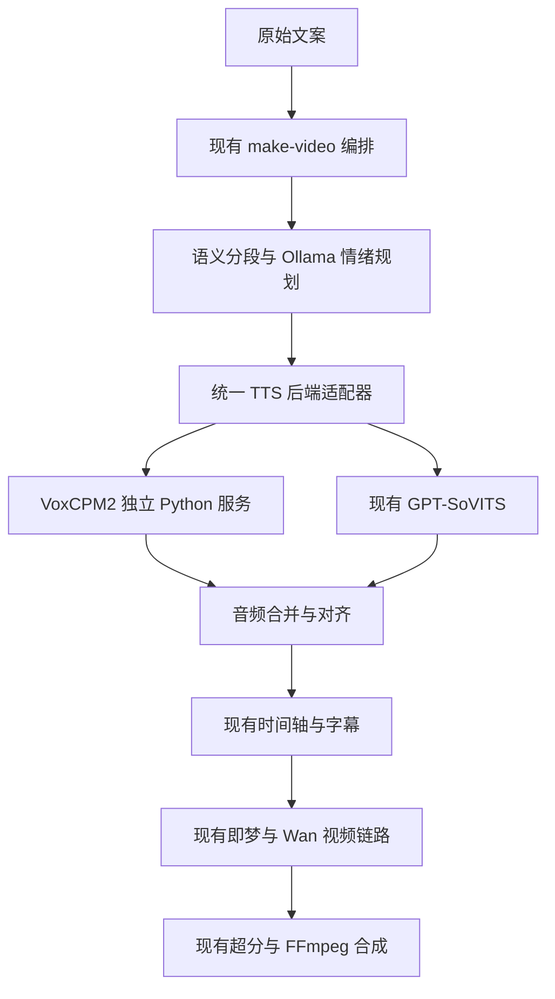

# VoxCPM2 本地语音生成服务接入设计

- 日期：2026-11-24
- 基线：v2；实施分支：v4
- 需求编号：TTS-VOX
- 状态：设计待实施，尚未完成真实 GPU 验证

## 1. 目标与边界

面向中文科普、助眠、AI 漫剧，支持 10–30 分钟文案、固定音色、情绪控制、声音设计、克隆、长文本分段、断点恢复。Windows + RTX 5090D V2（24GB）。本地 TTS 不依赖云 API。复用现有 Ollama、GPT-SoVITS 接入点、时间轴、字幕、存储、任务状态与服务生命周期；不另建业务编排系统。即梦生图、WanVideoWrapper fast、超分、合成及发布策略不变。不重新引入 GPU 租约、采样、准入或 /free。现有历史任务不得被隐式迁移。

依据：[v2 README](../README.md)（实施时以 v2 基线实际代码与契约为准）、[VoxCPM 官方仓库](https://github.com/OpenBMB/VoxCPM)、[权重](https://huggingface.co/openbmb/VoxCPM2)。模型/API/授权及加速框架兼容性需在部署时锁定版本验证；以下参数均为设计初值，不是实测结论。

## 2. 架构



语音单元与镜头单元解耦：按语义合并生成音频，用实际采样点和句级对齐映射原文范围，再交给现有镜头规划。不得用平均字数估算替代真实时间轴。即梦图片可在依赖满足时提前准备，但不改变现有生产策略或审查门槛。

## 3. 模型与服务

- 官方 VoxCPM2 PyTorch 优先，独立 Python 环境，Windows 本地 FastAPI（建议 127.0.0.1:9881，实际端口可配置）。
- 模型每个 TTS 阶段加载一次，串行推理；阶段结束停止本次拥有的进程，释放资源后再进入 Wan。不得接管外来进程。
- 目标输出 PCM16 WAV、48kHz、单声道；以实际模型输出为准，必要时统一转换一次。
- 生成模式：声音设计（建立音色资产）、固定参考音频克隆、可控克隆（默认生产模式）、音频续接（实验性，非默认）。
- 固定模型版本、依赖、参考音频及参数。参考音频须有使用授权。
- 初始参数 cfg_value=2.0、inference_timesteps=10、seed=42、关闭可选降噪；须验证真实 API 支持及效果后冻结。种子不保证跨设备或版本逐字节确定性。

核心调用示意（不是已验证代码）：
```python
from voxcpm import VoxCPM
import soundfile as sf

model = VoxCPM.from_pretrained("openbmb/VoxCPM2", load_denoiser=False)

def synthesize(text, instruction, reference_audio, output_path, seed=42):
    wav = model.generate(
        text=f"({instruction}){text}",
        reference_wav_path=reference_audio,
        cfg_value=2.0,
        inference_timesteps=10,
        normalize=False,
        denoise=False,
        retry_badcase=False,
        seed=seed,
    )
    sf.write(output_path, wav, model.tts_model.sample_rate, subtype="PCM_16")
```
参数及情绪指令语法以锁定版本实际接口为准。重试由业务层统一管理，避免与模型内部重试叠加。

## 4. 情绪导演与文本分段

复用 Ollama，对完整文案批量分析，只输出原文范围、情绪、强度、语气、停顿建议，不得改写原文。保存原文与实际合成文本的映射，数字、英文、单位和多音字规范化仅用于发音；字幕使用原文。规划失败可明确记录并使用默认叙事风格，不静默丢字。

情绪枚举：neutral、narrative、mystery、awe、excited、sad、lonely、gentle、tense、philosophical、angry、whisper。强度 0–1 是业务参数，映射为轻微/适度/明显等自然语言，不作为模型原生数值参数。固定音色和基础风格，结合前后文控制相邻情绪变化；普通叙述默认 narrative，关键段落增强情绪，避免每句突变。连续同情绪文本可合并。

初始语音单元 80–180 汉字，建议上限 250 字（须实测调整），优先段落/语义/句号，超长句才按其他标点拆分。句间停顿参考 150–300ms，段间 350–650ms，基于实际音频已有静音决定补充量，不机械叠加。保持尾音完整。全片响度统一，不逐段强压缩；默认关闭降噪。必要时短淡入淡出避免拼接杂音。

语音单元保存稳定 ID、原文半开范围、原文、合成文本、voice_id、emotion、intensity、instruction、seed、实际起止采样点。句级时间戳沿用现有对齐机制；若现有实现仅支持逐句 TTS，增加必要的强制对齐适配并验证（可评估 FunASR），不得伪造时间戳。对齐失败仅重试受影响单元或采用更细分段。

## 5. 服务契约（拟新增）

| 接口 | 用途 |
|---|---|
| GET /health | 就绪状态与模型版本 |
| GET /voices | 音色列表 |
| POST /voices/design | 创建音色资产 |
| POST /tts/generate | 幂等提交语音任务 |
| GET /tts/tasks/{id} | 查询原任务 |
| POST /tts/tasks/{id}/cancel | 请求取消，返回实际状态 |

优先复用现有 TTS 请求/响应契约；上述为适配器内部接口建议，不强制新增重复业务 API。仅监听 loopback；路径由运行根和受控资产解析器生成，禁止任意输出路径和路径穿越。

请求示例：
```json
{
  "request_id": "video_0001_tts_0001",
  "text": "旅行者一号从地球出发。",
  "voice_id": "male_narrator_01",
  "emotion": "narrative",
  "emotion_intensity": 0.3,
  "instruction": "沉稳自然，具有纪录片叙事感",
  "seed": 42,
  "cfg_value": 2.0,
  "inference_timesteps": 10
}
```
结果示例（非实测）：
```json
{
  "request_id": "video_0001_tts_0001",
  "status": "completed",
  "engine": "voxcpm2",
  "audio_path": "audio/segments/0001.wav",
  "sample_rate": 48000,
  "channels": 1,
  "duration_ms": 2850,
  "sample_count": 136800,
  "generation_time_ms": 780
}
```

## 6. 存储、配置与兼容

沿用 VIDEO_AI_RUNTIME_ROOT（默认 E:/VideoAI）及现有 storage resolver，不硬编码盘符或创建第二套运行根。建议目录：
```text
shared/models/VoxCPM2/
shared/envs/voxcpm2/
shared/assets/voices/male_narrator_01/reference.wav
shared/assets/voices/male_narrator_01/voice.json
shared/config/tts/voxcpm2.json
work/<number-title>/process/revisions/01/audio/
    emotion-plan.json
    segments/
    requests/
    narration.wav
    tts-result.json
```
实际目录以既有音频路径约定为准。新配置包含 engine、模型版本、voice_id、参考音频身份、base_style、seed、cfg_value、inference_timesteps、服务地址和分段策略。新任务显式选择 VoxCPM2；通过验收后再改默认。旧 GPT-SoVITS 任务继续使用冻结后端。切换已生成旁白须建立 revision，重建受影响时间轴/分镜/下游产物，不能原地覆盖或混合音色。

建议入口（待开发）：
```powershell
.\generate_video.cmd -Video 0001 -TtsEngine voxcpm2
.\generate_video.cmd -Video 0001 -TtsEngine gpt-sovits
```
默认切换后无参数入口保持不变；安装、迁移、离线模型路径与现有机制兼容。

## 7. 恢复、错误与必要校验

每个语音单元持久化 intent、请求身份、状态、尝试记录及产物。相同请求 ID + 同一冻结输入返回原状态/结果，不同输入拒绝。先写临时 WAV，检查格式/采样点后原子发布，完成记录与产物可恢复对账。未知提交先查询原任务，不能直接补单；确定失败最多额外两次尝试，保留失败诊断。取消须区分取消请求和真正停止。恢复只生成未完成或明确失败且获准重试的单元；缓存键包括模型版本、参考音频身份、文本、指令及推理参数。仅复用已确认产物，避免跨修订误用。

保留启动时模型/配置可用性检查、音色资产检查、分段原文覆盖、生成时 WAV 合法性和实际采样点、片段身份与状态、合并时总样本数。既有发布及必要恢复校验不扩大、不绕过。不新增每段模型权重哈希、全量资产扫描、重复解码、全量 ASR 强制校验、GPU 租约/持续监控。漏读与重复检测可选；真实试听作为质量验收，不由程序冒充。

## 8. 性能策略

第一阶段：官方实现、模型常驻本阶段、串行推理、批量情绪分析、已完成片段复用、关闭非必要降噪、验证 BF16。参考特征跨请求缓存须确认官方接口与音色/版本失效规则，不能假定已支持。TTS 结束关闭本次拥有的服务；不要影响外部进程。

第二阶段：独立评估 Nano-vLLM、批处理、CUDA Graph 等；先验证 Windows/Blackwell 兼容性和功能等价（不支持则保留官方实现）。用相同文案、参考音色、参数记录冷启动、热推理、RTF、峰值显存（仅基准实验，不加入生产监控）、重试率、端到端耗时及主观音质。RTF=生成耗时/音频时长，初始目标 ≤0.3，不能视作实测保证。

## 9. 实施任务

| 编号 | 任务 | 完成条件 |
|---|---|---|
| TTS-VOX-01 | 独立环境与模型部署 | Windows/5090D V2 真实加载与生成，版本冻结 |
| TTS-VOX-02 | 真实语音验证 | 与现有 GPT-SoVITS 同文案盲听，短/长段落、至少六种情绪、固定音色与 RTF 记录；决定是否继续 |
| TTS-VOX-03 | 本地 API 服务 | 生命周期、持久化任务、幂等查询、明确失败/取消 |
| TTS-VOX-04 | 现有 TTS 适配 | 双后端配置、现有调用契约和旧任务兼容 |
| TTS-VOX-05 | 情绪导演 | Ollama 结构化规划、原文覆盖、默认回退 |
| TTS-VOX-06 | 音色及长文案 | 音色冻结、分段、停顿、后处理和对齐 |
| TTS-VOX-07 | 恢复及生产接入 | 状态持久化、缓存、断点恢复、时间轴兼容 |
| TTS-VOX-08 | 完整视频验证 | make-video 实际短样片及长文案语音，现有视觉链路与交付回归 |
| TTS-VOX-09 | 性能优化 | 基准对照，收益和音质均达标才启用 |
| TTS-VOX-10 | 安装迁移及默认切换 | 安装/迁移验证、使用文档、显式默认切换和回退 |

依赖顺序：01→02（真实实验不通过则暂停后续改造）→03→04→05→06→07→08→09→10。09 的可选加速不达标时保留官方后端，不阻塞基础功能验收。

## 10. 验收

- 中文：真实试听无明显漏读、重复、错误发音，包含数字、单位、英文、多音字及科普术语；原文范围和字幕 100% 保留。
- 音色：30 分钟连续旁白无明显漂移；至少六种常用情绪可通过试听区分，尾音清晰，无明显拼接断裂。
- 性能：记录 5/10/30 分钟音频 RTF，目标热推理 ≤0.3；报告冷启动及后处理耗时。目标不达标如实记录，不编造通过。
- 恢复：故障注入覆盖生成前/中/后、写入与提交之间、未知请求、服务重启；已完成片段不重算。
- 兼容：旧 GPT-SoVITS 任务正常续作；即梦、Wan fast、超分、字幕、发布不发生非预期变化；实际短片音画同步。
- 资源：仅停止本次拥有的进程，无新增生产 GPU 采样；迁移后路径可重定位。
- 验收必须有真实 GPU 样本、音频、测试报告和主观试听记录。CPU mock 测试不代表真实语音质量通过。

## 11. 当前决策

先完成 TTS-VOX-01/02，再决定是否投入正式接入；不预先改造生产代码、不默认替换 GPT-SoVITS、不修改 Wan/即梦链路。后续详细任务设计应在阅读现有实际实现后拆分，不将本文示例路径和 API 当作已存在接口。
