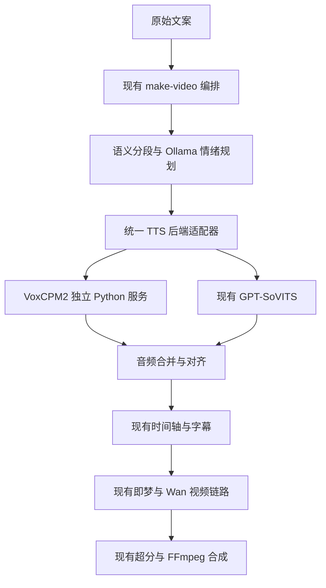

# VoxCPM2 本地语音生成服务接入设计

- 日期：2026-11-24
- 基线：v2；实施分支：v4
- 需求编号：TTS-VOX
- 状态：TTS-VOX-01/02 已完成（02 用户授权放行）；03 本地服务、04 双后端适配、05 情绪导演、06 音色及长文案已实现并通过相应真实验证，保留质量限制和回归的既有失败记录

## 1. 目标与边界

面向中文科普、助眠、AI 漫剧，支持 10–30 分钟文案、固定音色、情绪控制、声音设计、克隆、长文本分段、断点恢复。Windows + RTX 5090D V2（24GB）。本地 TTS 不依赖云 API。复用现有 Ollama、GPT-SoVITS 接入点、时间轴、字幕、存储、任务状态与服务生命周期；不另建业务编排系统。即梦生图、WanVideoWrapper fast、超分、合成及发布策略不变。不重新引入 GPU 租约、采样、准入或 /free。现有历史任务不得被隐式迁移。

依据：[v2 README](../README.md)（实施时以 v2 基线实际代码与契约为准）、[VoxCPM 官方仓库](https://github.com/OpenBMB/VoxCPM)、[权重](https://huggingface.co/openbmb/VoxCPM2)。模型/API/授权及加速框架兼容性需在部署时锁定版本验证；以下参数均为设计初值，不是实测结论。

## 2. 架构



语音单元与镜头单元解耦：按语义合并生成音频，用实际采样点和句级对齐映射原文范围，再交给现有镜头规划。不得用平均字数估算替代真实时间轴。即梦图片可在依赖满足时提前准备，但不改变现有生产策略或审查门槛。

## 3. 模型与服务

- 官方 VoxCPM2 PyTorch 优先，独立 Python 环境，Windows 本地 FastAPI（建议 127.0.0.1:9881，实际端口可配置）。
- 模型每个 TTS 阶段加载一次，串行推理；阶段结束停止本次拥有的进程，释放资源后再进入 Wan。不得接管外来进程。
- 目标输出 PCM16 WAV、48kHz、单声道；以实际模型输出为准，必要时统一转换一次。
- 生成模式：声音设计（建立音色资产）、固定参考音频克隆、可控克隆（默认生产模式）、音频续接（实验性，非默认）。
- 固定模型版本、依赖、参考音频及参数。参考音频须有使用授权。
- 初始参数 cfg_value=2.0、inference_timesteps=10、seed=42、关闭可选降噪；须验证真实 API 支持及效果后冻结。种子不保证跨设备或版本逐字节确定性。

核心调用示意（不是已验证代码）：
```python
from voxcpm import VoxCPM
import soundfile as sf

model = VoxCPM.from_pretrained("openbmb/VoxCPM2", load_denoiser=False)

def synthesize(text, instruction, reference_audio, output_path, seed=42):
    wav = model.generate(
        text=f"({instruction}){text}",
        reference_wav_path=reference_audio,
        cfg_value=2.0,
        inference_timesteps=10,
        normalize=False,
        denoise=False,
        retry_badcase=False,
        seed=seed,
    )
    sf.write(output_path, wav, model.tts_model.sample_rate, subtype="PCM_16")
```
参数及情绪指令语法以锁定版本实际接口为准。重试由业务层统一管理，避免与模型内部重试叠加。

## 4. 情绪导演与文本分段

复用 Ollama，对完整文案批量分析，只输出原文范围、情绪、强度、语气、停顿建议，不得改写原文。保存原文与实际合成文本的映射，数字、英文、单位和多音字规范化仅用于发音；字幕使用原文。规划失败可明确记录并使用默认叙事风格，不静默丢字。

情绪枚举：neutral、narrative、mystery、awe、excited、sad、lonely、gentle、tense、philosophical、angry、whisper。强度 0–1 是业务参数，映射为轻微/适度/明显等自然语言，不作为模型原生数值参数。固定音色和基础风格，结合前后文控制相邻情绪变化；普通叙述默认 narrative，关键段落增强情绪，避免每句突变。连续同情绪文本可合并。

初始语音单元 80–180 汉字，建议上限 250 字（须实测调整），优先段落/语义/句号，超长句才按其他标点拆分。句间停顿参考 150–300ms，段间 350–650ms，基于实际音频已有静音决定补充量，不机械叠加。保持尾音完整。全片响度统一，不逐段强压缩；默认关闭降噪。必要时短淡入淡出避免拼接杂音。

语音单元保存稳定 ID、原文半开范围、原文、合成文本、voice_id、emotion、intensity、instruction、seed、实际起止采样点。句级时间戳沿用现有对齐机制；若现有实现仅支持逐句 TTS，增加必要的强制对齐适配并验证（可评估 FunASR），不得伪造时间戳。对齐失败仅重试受影响单元或采用更细分段。

## 5. 服务契约（拟新增）

| 接口 | 用途 |
|---|---|
| GET /health | 就绪状态与模型版本 |
| GET /voices | 音色列表 |
| POST /voices/design | 创建音色资产 |
| POST /tts/generate | 幂等提交语音任务 |
| GET /tts/tasks/{id} | 查询原任务 |
| POST /tts/tasks/{id}/cancel | 请求取消，返回实际状态 |

优先复用现有 TTS 请求/响应契约；上述为适配器内部接口建议，不强制新增重复业务 API。仅监听 loopback；路径由运行根和受控资产解析器生成，禁止任意输出路径和路径穿越。

请求示例：
```json
{
  "request_id": "video_0001_tts_0001",
  "text": "旅行者一号从地球出发。",
  "voice_id": "male_narrator_01",
  "emotion": "narrative",
  "emotion_intensity": 0.3,
  "instruction": "沉稳自然，具有纪录片叙事感",
  "seed": 42,
  "cfg_value": 2.0,
  "inference_timesteps": 10
}
```
结果示例（非实测）：
```json
{
  "request_id": "video_0001_tts_0001",
  "status": "completed",
  "engine": "voxcpm2",
  "audio_path": "audio/segments/0001.wav",
  "sample_rate": 48000,
  "channels": 1,
  "duration_ms": 2850,
  "sample_count": 136800,
  "generation_time_ms": 780
}
```

## 6. 存储、配置与兼容

沿用 VIDEO_AI_RUNTIME_ROOT（默认 E:/VideoAI）及现有 storage resolver，不硬编码盘符或创建第二套运行根。建议目录：
```text
shared/models/VoxCPM2/
shared/envs/voxcpm2/
shared/assets/voices/male_narrator_01/reference.wav
shared/assets/voices/male_narrator_01/voice.json
shared/config/tts/voxcpm2.json
work/<number-title>/process/revisions/01/audio/
    emotion-plan.json
    segments/
    requests/
    narration.wav
    tts-result.json
```
实际目录以既有音频路径约定为准。新配置包含 engine、模型版本、voice_id、参考音频身份、base_style、seed、cfg_value、inference_timesteps、服务地址和分段策略。新任务显式选择 VoxCPM2；通过验收后再改默认。旧 GPT-SoVITS 任务继续使用冻结后端。切换已生成旁白须建立 revision，重建受影响时间轴/分镜/下游产物，不能原地覆盖或混合音色。

建议入口（待开发）：
```powershell
.\generate_video.cmd -Video 0001 -TtsEngine voxcpm2
.\generate_video.cmd -Video 0001 -TtsEngine gpt-sovits
```
默认切换后无参数入口保持不变；安装、迁移、离线模型路径与现有机制兼容。

## 7. 恢复、错误与必要校验

每个语音单元持久化 intent、请求身份、状态、尝试记录及产物。相同请求 ID + 同一冻结输入返回原状态/结果，不同输入拒绝。先写临时 WAV，检查格式/采样点后原子发布，完成记录与产物可恢复对账。未知提交先查询原任务，不能直接补单；确定失败最多额外两次尝试，保留失败诊断。取消须区分取消请求和真正停止。恢复只生成未完成或明确失败且获准重试的单元；缓存键包括模型版本、参考音频身份、文本、指令及推理参数。仅复用已确认产物，避免跨修订误用。

保留启动时模型/配置可用性检查、音色资产检查、分段原文覆盖、生成时 WAV 合法性和实际采样点、片段身份与状态、合并时总样本数。既有发布及必要恢复校验不扩大、不绕过。不新增每段模型权重哈希、全量资产扫描、重复解码、全量 ASR 强制校验、GPU 租约/持续监控。漏读与重复检测可选；真实试听作为质量验收，不由程序冒充。

## 8. 性能策略

第一阶段：官方实现、模型常驻本阶段、串行推理、批量情绪分析、已完成片段复用、关闭非必要降噪、验证 BF16。参考特征跨请求缓存须确认官方接口与音色/版本失效规则，不能假定已支持。TTS 结束关闭本次拥有的服务；不要影响外部进程。

第二阶段：独立评估 Nano-vLLM、批处理、CUDA Graph 等；先验证 Windows/Blackwell 兼容性和功能等价（不支持则保留官方实现）。用相同文案、参考音色、参数记录冷启动、热推理、RTF、峰值显存（仅基准实验，不加入生产监控）、重试率、端到端耗时及主观音质。RTF=生成耗时/音频时长，初始目标 ≤0.3，不能视作实测保证。

## 9. 实施任务

| 编号 | 任务 | 完成条件 |
|---|---|---|
| TTS-VOX-01 | 独立环境与模型部署（已完成，2026-11-24） | Windows/5090D V2 真实加载与生成，版本冻结；[部署与实测记录](voxcpm2-deployment.md) |
| TTS-VOX-02 | 真实语音验证（已完成，用户授权放行） | 用户明确授权通过并继续；保留偏好 Vox 8/GPT 0/未填 1、情绪 2/7、长时 RTF 0.750 及未验证项；[实验记录](voxcpm2-quality.md) |
| TTS-VOX-03 | 本地 API 服务（已完成） | 独立 loopback API、SQLite/完成回执、幂等冲突、取消与重启复用、拥有者退出已实测；[设计](task-designs/TTS-VOX-03-design.md)、[使用与验证](voxcpm2-service.md)；全套回归存在非本任务失败 |
| TTS-VOX-04 | 现有 TTS 适配（已完成，2026-11-25） | 双后端配置、统一 WAV 契约、冻结缺省值及旧任务快照兼容；真实 GPU 单样本与完成任务复用通过；[设计](task-designs/TTS-VOX-04-design.md)、[使用与验证](voxcpm2-adapter.md)；生产接线属 07，默认切换属 10 |
| TTS-VOX-05 | 情绪导演（已完成，2026-11-26） | Ollama 整篇结构化规划、原文精确覆盖、记录原因的默认回退；真实规划及一个 GPU 指令样本通过；[设计](task-designs/TTS-VOX-05-design.md)、[使用与验证](voxcpm2-emotion.md)；分段及生产接线仍属 06/07 |
| TTS-VOX-06 | 音色及长文案（已完成；最终参考版音色获用户确认） | 音色冻结、无损有限分段、按已有静音补停顿、全篇增益和实际采样点映射；1,153 字/41 单元/218.19 秒为历史技术验证；2026-11-27 用户选定 35.156 秒参考版旁白，固定 provided-reference-narration-v1；[已确认配方](approved-narration.md)、[设计](task-designs/TTS-VOX-06-design.md)、[使用与验证](voxcpm2-longform.md)；07 必须消费同一冻结配方，长时质量限制保留 |
| TTS-VOX-07 | 恢复及生产接入（已完成，2026-11-27） | 冻结已确认配方、reference-prompt 服务、原请求恢复、分层缓存与实测时间轴；真实 2 段/9.803 秒，恢复无新增请求；[使用与验证](voxcpm2-production.md)、[结果](research/TTS-VOX-07-result.json)；相关回归 172 passed / 3 skipped，8 项原字体夹具失败在 HEAD 基线复现 |
| TTS-VOX-08 | 完整视频验证 | make-video 实际短样片及长文案语音，现有视觉链路与交付回归 |
| TTS-VOX-09 | 性能优化（评估已完成，2026-11-28；保留官方后端） | 当前批准配方真实 GPU 两轮 AB/BA、6 对热样本，参考特征缓存收益 2.31%，低于 10% 门槛；原始/正文 PCM 全部一致但无新增主观试听，不启用候选；[设计](task-designs/TTS-VOX-09-design.md)、[性能记录](voxcpm2-performance.md)、[结果](research/TTS-VOX-09-result.json)；相关回归 63 passed / 3 skipped，RTF 未达 0.3 |
| TTS-VOX-10 | 安装迁移及默认切换（已完成，2026-11-28） | 固定部署、批准资产导入、离线环境重定位、候选验证后切换与字节备份回退；安装相关32项通过，真实GPU两段/8.960秒、恢复无新请求；[安装用法及限制](voxcpm2-installation.md)、[设计](task-designs/TTS-VOX-10-design.md)、[结果](research/TTS-VOX-10-result.json) |

依赖顺序：01→02（真实实验不通过则暂停后续改造）→03→04→05→06→07→08→09→10。09 的可选加速不达标时保留官方后端，不阻塞基础功能验收。2026-11-28 用户明确要求完成 09，已在当前批准旁白配方上完成独立性能评估；不据此补记 08 验收，也不自动启动 10。

## 10. 验收

- 中文：真实试听无明显漏读、重复、错误发音，包含数字、单位、英文、多音字及科普术语；原文范围和字幕 100% 保留。
- 音色：30 分钟连续旁白无明显漂移；至少六种常用情绪可通过试听区分，尾音清晰，无明显拼接断裂。
- 性能：记录 5/10/30 分钟音频 RTF，目标热推理 ≤0.3；报告冷启动及后处理耗时。目标不达标如实记录，不编造通过。
- 恢复：故障注入覆盖生成前/中/后、写入与提交之间、未知请求、服务重启；已完成片段不重算。
- 兼容：旧 GPT-SoVITS 任务正常续作；即梦、Wan fast、超分、字幕、发布不发生非预期变化；实际短片音画同步。
- 资源：仅停止本次拥有的进程，无新增生产 GPU 采样；迁移后路径可重定位。
- 验收必须有真实 GPU 样本、音频、测试报告和主观试听记录。CPU mock 测试不代表真实语音质量通过。

## 11. 当前决策

用户在查看 02 评审后明确表示“我可以授权VoxCPM2通过，你继续吧”。据此完成 02，并已完成 03 独立本地 API 服务与真实 GPU 验证。原始盲听结论、情绪 2/7、长时 RTF 0.750 及未验证项保留，不伪造达标。03 的新服务及相关旧服务测试通过，整体回归仍有候选图调度测试失败，详见服务文档，不声称全套通过。用户随后明确请求完成 04，现已完成双后端适配及真实 GPU 短样本；最终相关回归 225 passed / 3 skipped，另保留在修改前源码上复现的 8 项字体夹具/预检既有失败。默认仍为 GPT-SoVITS，07 接生产编排与恢复，10 切默认。

2026-11-26 用户请求完成 05：独立情绪导演已实现，真实 Ollama 对混合短文单次返回四种情绪并保留全部原文，一个 awe 范围通过 04 工厂生成 2.88 秒 GPU WAV，实际服务冻结指令核对通过。独立审查的非法 Unicode 回退问题已用 RED→GREEN 修复，最终相关回归 341 passed / 3 skipped。没有新增主观试听结论、完整视频或长文真实生成结论，不改变 06/07/10 边界与 02 既有质量记录。

2026-11-26 用户请求完成 06：已实现固定音色、长文分段、停顿补差、全篇恒定增益和独立 TTS 单元的实际采样点映射。初次三字情绪过渡“看啊，”生成近乎静音样本，合并明确失败；调整同句内极短情绪分段后，复用 40 个相同冻结输入的已完成请求，仅新生成 1 个单元，最终 1,153 字/41 单元/218.19 秒旁白和原文覆盖通过。模型生成 RTF 0.843，未达 0.3；无新增主观试听或 30 分钟音色稳定结论。独立审查的 7 项 P2 及真实极短分段问题均已修复，最终相关回归 337 passed / 3 skipped。06 提供独立模块，07 仍负责生产恢复、缓存及旧时间轴适配，10 再切默认。

2026-11-27 用户指出声音不对，明确要求纪录片助眠男声。根因为旧参考音频被固定克隆，通用风格指令不能保证新音色需求。现已新增显式 Vox 音色资产选择，独立声音设计生成 `male-sleep-documentary-v1`，用新参考实际生成 35.074 秒短旁白，保存 gentle/.15/舒缓偏好。相关回归 271 passed / 3 skipped，独立审查的 3 项 P2 已修复。主观状态为 generated_pending_listening；不把生成成功或技术测试当作男声/助眠效果通过。07 必须消费 `shared/config/tts/male-sleep-documentary.json`，不能继续默认沿用旧参考。

后续用户反馈 v1 不够稳定、自然；持久偏好改记 `needs_revision`。已完成一次小规模试听修订：A 为旧参考+精简指令+整段连读，B 为新平实男声参考+官方参考续读+整段生成。两版待用户试听，不自动更换生产偏好；B 的续读模式尚未接入服务，整段只有实际总时长，不伪造句级时间。详见[自然度试听记录](voxcpm2-natural-voice.md)。

用户继续要求语速更慢、多段之间保持一致。已沿用 B 的 v2 参考实际生成三段连续样本，各段固定同一参考音频/参考文本/seed/cfg/steps，无逐段情绪指令，再统一 `atempo=0.8` 保留音高地放慢。按变速后实际采样点保存段级边界，未伪造句级对齐。持久偏好记录所需语速、一致性及候选配方路径，主观状态仍待试听；07 必须显式消费参考续读与变速后对齐条件，见[多段慢速记录](voxcpm2-consistent-voice.md)。

用户随后确认“声音有点太低沉了，其他没问题”：据此记录语速、自然度及跨段一致性已接受，只保留音色轻调待试听。已直接复用同一 48.922 秒成品，全篇 low-shelf 180Hz / -2.5dB 减轻低频厚重感，未重新生成或改变音高、语速、采样点和段落位置。最新持久偏好保存 v2 参考续读、0.8 倍语速及 tone_filter，07 须重现这些条件。[微调记录](research/TTS-VOX-06-tone-adjust-result.json)。

用户再反馈声音仍略重、语速略快：当前候选改为 0.75 倍语速、180Hz / -4dB low shelf、保留共振峰的 +0.75 半音；复用同一组三段原始生成，没有再次 GPU 合成。变速及轻提音高后按实际 PCM 重新累计段级时间。最新偏好已更新完整从 raw-tts 开始的后处理链，07 不得重复变速；语速/音色接受状态改为待试听，自然度与跨段一致性方向仍保留。[最新记录](research/TTS-VOX-06-lighter-slower-result.json)。

用户随后拒绝该版助眠听感，要求查资料并生成，澄清目标为“男声本身低刺激、平稳柔和，不加嗡鸣”。已检索并读取催眠师录音研究、双耳节拍系统综述和声音助眠综述，不将特定 Hz 宣称为必然催眠。新 `male-soft-narration-v3` 使用放松轻声参考，两段正文固定同一参考续读，撤去升调和大幅削低频，仅轻减高频、0.75 倍语速、段间 1.2 秒、全篇 RMS 目标 -25dBFS；不加任何底音。已真实生成短样本，持久偏好 pending_user，不能把技术成功当成睡眠效果通过。[资料与新样本](voxcpm2-low-stimulation-research.md)。

用户认为 v3 方向快对了，但不喜欢音色。已保留文案、参考原文、正文参数及低刺激后处理，只设计两个替代男声参考：A 清润方向、B 温和圆润方向；两版各自共用固定参考生成两段正文。输出与资产独立保存，当前选定音色未变更，状态 `voice_replacement_pending`，待用户试听选择。[音色试听记录](voxcpm2-soft-voice-audition.md)。

用户继续拒绝两版低沉音色，要求清亮轻盈、避免生硬哄睡，且目前没有参考样例。本轮去掉轻声气声/睡前陪伴设计提示、高频衰减及引导放松文案，改用自然聊天式青年男声参考与海边风景叙述。有限诊断后复用该批音区最高的 E-clear-tenor；没有把任意 Hz 阈值当成感知质量或催眠效果。正文使用同一参考续读，原始生成统一 0.6 倍后处理保持慢节奏，无 EQ、升降调或底音，按实际采样点重建段级时间。当前只提供一份新样本待试听，尚未选定最终音色。[自然聊天版记录](voxcpm2-bright-casual-voice.md)。

用户随后提供 `Downloads/test.mp4`：前/中/后共 90 秒抽样及中段人声估计表明，该参考是自然科普讲述，估计整体字速约 278–294 字/分钟；中段估计基频约 123Hz，与最新生成样本接近，不能把清亮感简化为提高音高。用户要求继续后，已使用其中 14 秒分离人声作为固定参考，实际生成两段新星空文案。固定参考续读与推理参数，仅 0.95 倍轻微降速、850ms 段间补足和 -23dBFS RMS 目标，无背景音、升降调或大幅拖慢。源视频未改动，参考转写未经人工逐字确认，候选仍待试听。[参考版旁白记录](voxcpm2-reference-narration.md)。

2026-11-27 用户确认“用这个音色吧，后面所有视频都按照这个声音生成”：上一段候选现已获确认，06 音色选择完成。唯一默认音色为 `provided-reference-narration-v1`，权威配方为运行根 `shared/config/tts/default-narration.json`，仓库冻结副本为 `config/approved-narration.json`。参考音频、参考转写、模型与源码版本、reference-prompt 模式、seed=42/cfg=2/steps=20，以及 0.95 倍语速、850ms 段间补足、-23dBFS 全篇 RMS 目标均冻结；不逐段切换情绪或声线。[确认记录与入口边界](approved-narration.md)。当时仅保存默认规范，入口尚未接线。

同日用户请求完成 07：正式生产语音入口已消费相同冻结配方，运行根 production.json 已显式启用，配置切换前备份保留。任务内冻结参考与转写，服务支持无情绪前缀的 reference-prompt；按稳定原请求 ID 恢复，原始/变速/全篇结果分别缓存，FunASR CPU 时间戳在变速后测量并切回原有字幕单元，PCM 不丢失或重复，时间轴不重复加停顿。真实生产函数生成 2 段/470,524 采样点/9.802583 秒，完整恢复仍仅 2 个请求；独立审查两项 P2（网络中断退出误取消已接受任务、不支持字符被静默删除）均已修复。相关回归 172 passed / 3 skipped，8 项字体夹具失败在未修改 HEAD 的独立基线同样复现。不增加主观试听、长时稳定或完整视觉视频结论；08 仍负责完整视频，10 仍负责安装迁移。已有任务继续使用原冻结快照，不隐式迁移。

2026-11-28 用户请求完成10：固定版本联网/离线入口、批准资产导入、验证后发布候选、共享依赖与venv重定位、明确默认启用与原始字节备份回退已完成。安装相关32项通过；当前安装离线核对成功；隔离新根真实包启动成功；正式生产语音两段8.959583秒且恢复不新增请求。扩展回归136 passed / 3 skipped / 5项既有字体夹具失败；第二台新机器全量联网安装未实测。详情见 docs/voxcpm2-installation.md，不改变08完整视觉验收状态。
